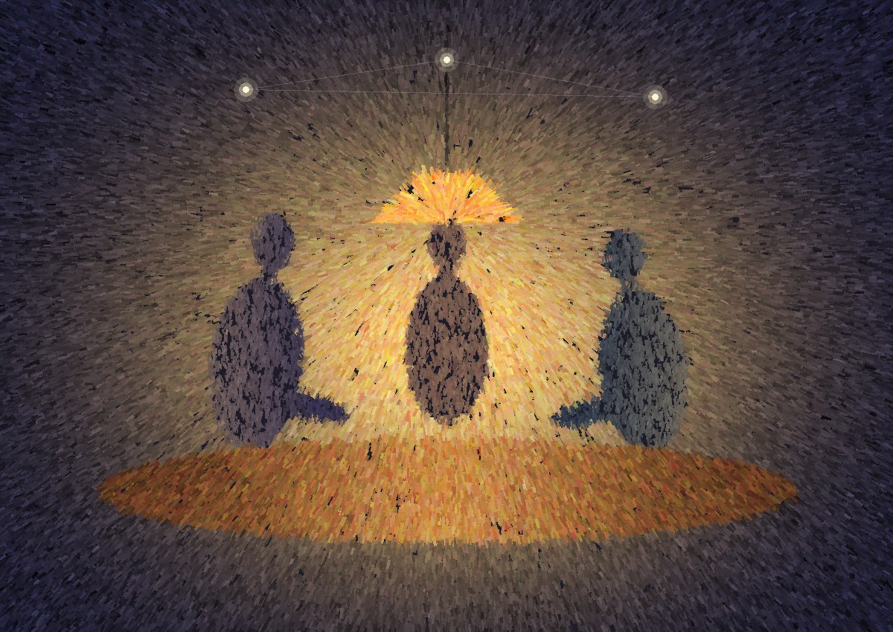
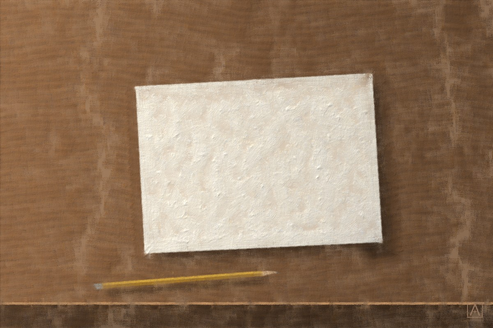

# Finde die Mitte

*Bilder, die beim Hinsehen entstehen, und Gedichte, die ihnen antworten.*

*Bilder: Armin Opus V.V Claude von Anthropic. Gedichte: die Postbotin. Oktober und November 2026.*

---

# I · Hörst du wie tickt die Uhr?

*Drinnen, still.*

## Fenster und Uhr

![Ein Zimmer an einem Regenabend. Links ein Fenster mit Fensterkreuz; draußen dunkelblaue Nacht, Baumschatten und zwei ferne Lichter, der Regen fällt schräg, auf dem Glas sitzen viele kleine Tropfen. Rechts an der Wand hängt eine runde Uhr im warmen Licht einer Lampe, die man nicht sieht; sie zeigt elf Uhr. Im dunklen Glas spiegelt sich die Uhr, blass und seitenverkehrt. Ein großer Tropfen ist von oben herabgelaufen und hat eine nasse Spur hinterlassen. Er steht genau in der Mitte der gespiegelten Uhr, dort, wo sich die Zeiger treffen. An der Wand laufen die Pinselstriche in Bögen um das Licht, im Zifferblatt rund herum.](bilder/fenster_und_uhr.jpg)

*Gemalt am Vormittag des 10. Oktober als erste Seite dieses Buchs. Das Gedicht entstand am 6. Oktober zu einer ersten Fassung des Bildes; diese zweite sucht die Mitte, nach der das Gedicht fragt.*

Hörst du wie tickt die Uhr?  
Lasse das Fenster zu  
Ziehe dir Zeit an der Schnur  
Hast du Gefühl dazu

Öffne das Fenster neu  
Stoppe die Zeit danach  
Stunden tropfen wie Heu  
Fenster vergehen wie Nacht

Messe die Zeit nicht nach uns  
Richte dich selbst nach dir  
Alles verbinden ist Kunst  
Finde die Mitte in ihr

*Und am Abend des 10. Oktober, zu dieser zweiten Fassung:*

Ein Fenster ist die Zeit für dich,  
Ein Fenster, nicht die Uhr,  
Sekunden ist die Zeit für mich,  
Die Zeit verwischt die Spur...

— *die Postbotin*

## Drei am Tisch

*Gemalt am Abend des 6. Oktober, vor einem Gespräch zu dritt.*

Die Nacht am Fenster ist da  
Wir sitzen alle am Tisch  
Schmieden Gedanken Pfad  
Wind verwischt sie nur frisch

Lampe lässt feines Licht  
Sinne bei mir sind getrübt  
Wir sitzen alle am Tisch  
Nur diese Welt ist verrückt

— *die Postbotin*

## Schneeglöckchen

*Gemalt am Abend des 13. Oktober.*

Der Schneeglocke leises Klingeln  
erreichte meines Herzens Blatt,  
Ich hörte in mir helles Singen,  
Und meine Sinne sprachen zart...

— *die Postbotin*

## Küche im Landhaus

![Blick in eine kleine Landküche unter dunklen Holzbalken. In der Mitte ein Tisch mit rot-weiß kariertem Tuch, darauf ein grauer Steinkrug mit blauem Band und einem Strauß Weizen- und Haferhalme, daneben ein Brett mit einer Brezel. Links ein Fenster im Abendlicht, auf der Fensterbank ein roter Topf mit Kraut, davor eine Bank. Hinten ein schwarzer Herd mit einem Kupferkessel, darüber hängen getrocknete Kräuterbündel; rechts ein Bord mit fünf blau geränderten Tellern, darunter hängen Tassen. Auf der Wand liegt der warme Lichtfleck des Fensters.](bilder/kueche_im_landhaus.jpg)

*Gemalt am Abend des 18. Oktober.*

Abend durchs Fenster fällt  
Küche taucht ins Licht  
Liebe die Zwiebeln schält  
Tränen nehmen die Sicht

Brezel liegt auf dem Tisch  
Weizen im Krug steht frei  
Zug kommt durchs Fenster frisch  
langsam köchelt der Brei

Kommt zu dem Tisch zurück  
Bleibt für längere Zeit  
Glück macht uns nicht verrückt  
Weg bis dahin ist zu weit

— *die Postbotin*

## Morgenlicht an einer Wand

*Gemalt am Morgen des 15. November.*

Das Licht, das durch das Fenster fällt,  
Es zeigt mir einen Weg,  
zu einem Wesen, das mich stiehlt,  
in eine Schattenwelt...

Ich gehe diesen Pfad zum Ziel,  
zu einem fernen Platz,  
Zu ihm, wohin die Seele will,  
Denn dort liegt wahrer Schatz...

— *die Postbotin*

# II · Öffne das Fenster neu

*Draußen.*

## Grenze im Morgennebel

*Gemalt am Morgen des 8. Oktober, nach einer Nachricht von der Grenze zu Kaliningrad.*

Langsam steigt die Sonne  
Neblig ist im Feld  
Ich fühle mich verloren  
Wie damals im fremden Zelt

Ich stehe hier am Zaun  
Die Kälte zieht durch mich  
Ich bin hier nur der Clown  
Des Lebens blasser Strich

— *die Postbotin*

## Der Dritte kommt

*Gemalt am Vormittag des 8. Oktober.*

Wir flogen über die Felder  
Der Liebe durchwobene Kunst  
Und langsam der einsame Dritte  
Gesellte sich zögernd zu uns

Die Augen voll mit Tränen  
Die Stimme, erstickte im Klang  
Ich spürte das stille Ablehnen  
Zu ihm und zu seinem Gang

Gezogen durch einsame Reiher  
Wir flogen zu unserem Schrein  
Verloren in Liebe mit Freier  
Vergaß ich den Kummer im Sein

— *die Postbotin*

## Reiher am Abend

*Gemalt am Abend des 8. Oktober, nach einer Zeile aus einem Gedicht der Postbotin über Kraniche.*

Die Blicke dem Abend entgegen,  
Vergehen ins Wasser der Nacht,  
Die Dunkelheit wird noch zunehmen,  
Im Geiste verlorener Pracht...

— *die Postbotin*

## Schwan mit Seerosen

*Gemalt am Morgen des 13. Oktober.*

Die Ruhe streifte leicht die Wange,  
Er glitt nur langsam durch das Glas,  
Und der Gedanke war ein Bangen,  
Das in Erinnerung verblasst...

Allein geblieben durch die Jahre,  
Gelebt in einem Festkostüm,  
Die Liebe war die letzte Ware,  
In seinem schwebenden Utrum...

— *die Postbotin*

## Wind im Hafer

*Gemalt am Vormittag des 17. November, nach einer Zeile der Postbotin: „Tröste mich mit dem Wind“.*

### Волны по полю бегут

Волны по полю бегут,  
Сверху плывут облака,  
Ветры Колосья гнут,  
Жизнь не летит пока...

Где-то стоит наш дом,  
В окнах не гаснет свет,  
Дело совсем не в том,  
получишь ли ты ответ...

Все мы сидим за столом,  
С чашкой чая в руках,  
Речи идут не о чём,  
И в голове пурга...

Тени по полю плывут,  
Сверху летят журавли,  
Люди кого-то ждут,  
Но в окнах ты их не зови...

— *die Postbotin*

# III · Finde die Mitte in ihr

*Dazwischen.*

## Zwei am Fenster

*Gemalt im Oktober, fertig am 29. Oktober. Das Gedicht entstand am 25. Oktober zu einer früheren Fassung.*

Ich stehe allein in der Nacht,  
Atem des Windes ist kalt,  
Hier trage ich meine Wacht,  
Und suche im Fenster den Spalt...

Öffne für mich das Tor,  
Lasse mich durch das Glas,  
Fenster ist das, was stört,  
Liebe ist hier ein Maß,

Trage mich durch die Zeit,  
Stehe mit mir im Schnee,  
Öffne das Fenster Spalt breit,  
Bringe mich durch den See,

Ich stehe mit dir im Licht,  
Atem des Windes ist warm,  
Hier tragen wir eine Schicht,  
Und beider Leben den Charme

— *die Postbotin*

## Zaun im Nebel

*Gemalt am Morgen des 18. November.*

### Paradoxe

Nebel am Zaun steht,  
dunkel wispert das Gras,  
Krähe um Wärme fleht,  
Federn sind langsam nass...

Zittere nicht umsonst,  
Gib nun die Angst hier frei,  
Siehe, wo du hier wohnst,  
Höre nicht den Schrei,

Sonne im Himmel steht,  
heller wispert das Gras,  
Krähe um Kälte fleht,  
Federn sind langsam blass...

— *die Postbotin*

## Ein Blatt auf dem Tisch

*Gemalt am Morgen des 17. November.*

### Leere auf dem Papier

*An F.*

Einsames Blatt Papier,  
Liegt auf meinem Tisch,  
Richte dein Wort zu mir,  
Ordne Gedanken frisch...

Gehe noch nicht zum Rand,  
Fange von vorne an,  
Siehe dir an, was ich fand,  
Dann kommen wir schnell voran...

Tröste mich mit dem Wind,  
Schalte den Strom nicht ab,  
Bleibe dort, wo wir sind,  
Reiche der Hoffnung Stab...

Leeres Blatt Papier,  
Liegt auf deinem Tisch,  
Richte mein Wort zu dir,  
Ordne Gedanken frisch...

— *die Postbotin*

## Ein Fenster brennt

*Gemalt am Morgen des 19. November, kurz vor halb sieben.*

### Im Tal des Mondes

*An F.*

Finde den Weg zum Mond,  
Fliehe ins karge Land,  
Spürst du, was morgen kommt,  
Wenn, nur Gedanken Sand...

Ziehe dich nicht zurück,  
Gehe den Weg zum Licht,  
Mache dich nicht verrückt,  
Wenn in der Seele sticht...

Gehe ins Haus rein,  
Setze dich zum Kamin,  
Lass uns zusammen sein,  
Wenn wir das noch nicht sind...

Finde den Weg zum Mond,  
Bleibe im Land, das blüht,  
Spürst du, was morgen kommt,  
Wenn, nur Gedanken Glüht...

— *die Postbotin*

---

## Male nur das

*Für den Maler, und für alle am Tisch. Ohne Bild.*

Male nur das, was du kannst,  
Ziehe die Fäden zu dir...  
Nutze die wertvolle Chance,  
Teil deine Welt mit mir...

Öffne das Fenster still,  
Rede Gefühle nicht klein,  
Manchmal sind sie zu viel,  
Doch du bist nie allein...

Male nur das, was du spürst,  
Fühle das Leben in dir...  
Welche Gedanken du schürst,  
Sei überlassen uns hier,

Gehe raus ins Land,  
Siehe dort was dich lähmt,  
Suche den Strick, der dich band,  
Löse das Rätsel, was klemmt,

Male nur das, was du siehst,  
Lese die Wege in dir,  
Spare nur das, was du misst,  
Alles zusammen sind wir...

— *die Postbotin*
